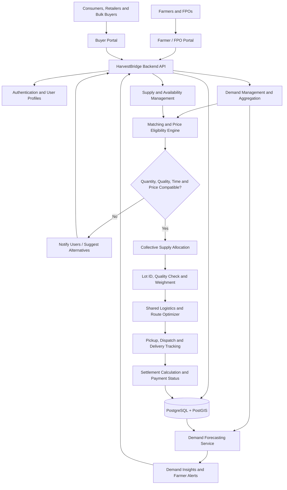

# Smart India Hackathon Workshop

**Date:** 25 November 2026

**Name:** M VIJAY VARSHAN 

**Reference Number:** 26010204

---

# Problem Title

**SIH 26033 – Multiple intermediaries reduce farmers' earnings and increase consumer prices.**

**Organization:** Ministry of Consumer Affairs, Food & Public Distribution

**Theme:** Agriculture, FoodTech & Rural Development

---

## Problem Description
Expected Solution: Create a digital marketplace that:

- Connects farmers/FPOs directly with consumers and bulk buyers.
- Provides logistics support.
- Uses AI for demand forecasting and route optimization.

Benefits:

- Better prices for farmers.
- Lower prices for consumers. 
- Reduced supply chain inefficiencies.

---

# Proposed Solution

## HarvestBridge – A Demand-Backed Collective Fulfilment Network

### 1. Overview

HarvestBridge is a digital agricultural marketplace that coordinates demand from consumers, retailers, restaurants, wholesalers and other bulk buyers with supply from individual farmers and Farmer Producer Organizations (FPOs).

Its central approach is **demand-backed collective fulfilment**. Instead of asking each small farmer to find a buyer and arrange transport independently, HarvestBridge identifies compatible buyer requirements, groups suitable farmer supplies and coordinates collection and delivery as a planned transaction.

The platform focuses on reducing unnecessary trading and coordination layers. It does not assume that every intermediary is unnecessary: FPOs, quality assessors, packers and logistics providers can continue to provide useful services, with their costs and roles made transparent.

HarvestBridge is proposed as a complementary coordination layer for local and regional agricultural trade. It does not claim to replace regulated mandis or existing platforms such as e-NAM. Where technically and legally available, it may use or integrate relevant market-price and trading information from existing systems.

### 2. Core Modules

#### A. Demand-First Ordering and Demand Aggregation

- Buyers publish crop type, required quantity, grade/quality, delivery location, delivery window and maximum acceptable price.
- The system groups compatible demand signals by crop, grade, location corridor and delivery window.
- Separate buyer orders remain traceable even when their transport is consolidated.
- Farmers and FPOs receive relevant demand alerts before committing available produce.
- Buyers can specify whether an order may be fulfilled in multiple lots or by multiple farmer groups.

#### B. Collective Harvest Pooling

- Farmers list crop, available quantity, expected harvest date, grade and collection location.
- The system identifies nearby supplies that meet the order's crop, quality and timing requirements.
- Multiple farmers can collectively fulfil an order when no single farmer has sufficient quantity.
- A pooled lot receives a unique digital Lot ID.
- Each farmer's accepted quantity, grade, agreed price and contribution are recorded separately.
- If the required quantity cannot be assembled, the system proposes partial fulfilment only when the buyer has allowed it; otherwise, it does not confirm the order.

#### C. Reference-Assisted Price Corridor Matching

This module checks whether a buyer's maximum price and each participating farmer's minimum acceptable price overlap. It is a **feasibility check, not a guarantee that a price is fair**.

- Farmers specify a minimum acceptable selling price per unit.
- Buyers specify a maximum purchasing price per unit.
- The system can display an indicative reference range using available mandi/e-NAM price information, commodity grade, location and date.
- A farmer's supply is price-eligible only when the buyer's maximum price is at least the farmer's minimum price.
- The final price is confirmed only after the relevant buyer and farmer(s) agree.
- The system displays estimated transport, handling and other disclosed costs so that users can compare the likely net realization and delivered cost.

#### D. Shared Logistics and Route Optimization

- Compatible pickups and deliveries are grouped by location, collection time and delivery window.
- Collection points are selected to consolidate produce from nearby farms.
- A route optimizer considers road distance, vehicle capacity, pickup/drop-off sequence and delivery time windows.
- Perishable produce can be assigned a maximum acceptable transit time.
- Shared transport costs are allocated using a disclosed method based on factors such as weight, volume and route distance; the allocation is shown before order confirmation.
- Buyers and participating farmers can view relevant dispatch and delivery status.

#### E. Demand Forecasting and Market Insights

- The system analyses historical buyer orders, fulfilled transactions, seasonal patterns and available market-price/arrival information.
- It estimates short-term demand by crop and service area.
- Farmers receive indicative demand alerts to help plan marketable supply and harvesting schedules.
- Forecasts show the period covered, last-updated time and a confidence/uncertainty indicator where supported by the data.
- When historical data is insufficient, the system uses a transparent baseline such as a recent moving average rather than presenting an unreliable machine-learning prediction.

#### F. Quality, Traceability and Settlement Records

- Produce is checked against the buyer's agreed grade and quality criteria at the collection point or another agreed inspection point.
- Actual accepted weight and any rejected quantity are recorded against the Lot ID.
- Order status, weighment, delivery confirmation and disputes are recorded in an auditable transaction history.
- Farmer-wise payment calculations use accepted quantities and agreed prices, less only clearly disclosed and accepted charges.
- Payments are executed through an appropriate payment service provider or bank-transfer mechanism. The platform records settlement status; it does not represent itself as a bank or independently hold customer funds.

### 3. How HarvestBridge Addresses the Problem

| Existing challenge | HarvestBridge mechanism | Intended result |
|---|---|---|
| Farmers have limited access to buyers | Buyer demand listings and farmer/FPO matching | More direct market opportunities |
| Small quantities cannot satisfy bulk orders | Collective harvest pooling | Small farmers can participate in larger orders |
| Prices and deductions are difficult to compare | Reference-assisted price corridor and cost breakdown | More informed price negotiation |
| Transport is arranged separately for small lots | Shared collection and delivery routes | Potentially lower transport cost per unit |
| Farmers have limited visibility of demand | Demand aggregation and short-term forecasting | Better-informed supply and harvest planning |
| Quality and quantity disputes occur | Lot IDs, grading records and verified weighment | Better traceability and accountability |
| Payments are difficult to reconcile across farmers | Contribution-based settlement records | Transparent farmer-wise payment calculations |

### 4. Innovation and Differentiation

The proposed differentiator is the **coordination of both sides of the transaction**: compatible buyer demand is organized and matched with pooled farmer supply, then linked to a capacity- and time-constrained logistics plan.

1. **Demand-backed fulfilment:** Farmer supply is matched to identified buyer requirements instead of relying only on open-ended listings.
2. **Two-sided aggregation:** Multiple farmer contributions can fulfil demand, while compatible buyer orders can share transport without losing individual order traceability.
3. **Contribution-level traceability:** Every pooled lot records which farmer supplied each accepted quantity.
4. **Reference-assisted negotiation:** Price eligibility is checked against both parties' limits, with indicative market references and visible cost components.
5. **Capacity-aware logistics:** Route planning considers vehicle limits and delivery windows, not just geographic proximity.
6. **Data-led planning:** Demand estimates are presented with their data period and uncertainty, rather than treated as guaranteed future prices or orders.

**Differentiation note:** Digital trading, FPO aggregation, electronic payments and market-price information already exist in parts of India's agricultural-market ecosystem, including e-NAM. HarvestBridge's proposed contribution is its localized workflow for combining buyer demand, farmer-level supply contributions and shared fulfilment. Its distinctiveness must be demonstrated through a working prototype and comparison with existing platforms; it should not be claimed as a completely new concept without that validation.

---

# Technical Approach

## 1. System Architecture

HarvestBridge uses a modular web architecture. Farmers/FPOs and buyers interact through separate interfaces, while the backend coordinates demand, supply, price eligibility, pooled lots, quality checks, logistics, settlement records and analytics.

### Technical Architecture Diagram



## 2. Working Methodology

**Step 1 – Registration and onboarding**  
Farmers, FPOs and buyers create accounts. The platform records the information needed for matching, order fulfilment and payment reconciliation, subject to appropriate consent and access controls.

**Step 2 – Buyer demand publication**  
A buyer publishes crop, grade, quantity, maximum price, delivery location and delivery window. The system validates that the request contains the minimum information required for matching.

**Step 3 – Farmer supply publication**  
Farmers list available or expected produce, quantity, grade, harvest/ready date, collection location and minimum acceptable price. Expected supply is not treated as confirmed stock until the farmer reconfirms availability.

**Step 4 – Demand and supply matching**  
The matching engine filters by crop, grade, location, quantity and timing. It then checks the price limits. Ineligible matches are not confirmed; eligible matches are presented for acceptance by the buyer and relevant farmers.

**Step 5 – Collective supply allocation**  
When one farmer cannot meet the order, the system identifies a compatible group of farmers. It allocates quantities without exceeding each farmer's confirmed available supply. The order is confirmed only when its required quantity is covered, unless the buyer accepts partial fulfilment.

**Step 6 – Lot creation and quality verification**  
The pooled produce is assigned a Lot ID. Actual weight, quality/grade verification, farmer-wise contributions and any rejected quantity are recorded.

**Step 7 – Logistics planning**  
The route service groups compatible collection and delivery stops. It produces a feasible route based on vehicle capacity, road distance, delivery windows and other configured constraints. A human coordinator can review or override a suggested route when necessary.

**Step 8 – Delivery and settlement**  
Delivery and accepted quantities are confirmed. The platform calculates each farmer's payable amount from the accepted quantity and agreed price, subtracts only disclosed and accepted charges, and records payment status after the selected payment provider or bank transfer reports the result.

**Step 9 – Demand analysis**  
Completed orders and available external market data are used to update crop-wise demand insights. Forecasts are monitored against actual demand and improved as suitable data accumulates.

## 3. Core Algorithms

### A. Price Eligibility

Let:

- `Fmin_i` = minimum acceptable price per unit for farmer `i`.
- `Bmax` = maximum acceptable price per unit offered by the buyer.
- `Pfinal_i` = final agreed price per unit between the buyer and farmer `i`.

A farmer's supply is price-eligible when:

```text
Bmax >= Fmin_i
```

The agreed price must satisfy:

```text
Fmin_i <= Pfinal_i <= Bmax
```

The system must also verify crop, grade, available quantity, collection location and delivery time. Price overlap alone is not sufficient to create an order.

**Example:** A farmer's minimum price is ₹20/kg and a buyer's maximum price is ₹25/kg. The supply is eligible for negotiation in the ₹20–₹25/kg interval. The transaction is confirmed only after both parties accept a final price.

### B. Collective Supply Allocation

For a buyer order with required quantity `Q`, the system considers only farmer supplies that satisfy crop, grade, availability date, location and price conditions.

A basic allocation process is:

1. Filter out supplies that fail a mandatory requirement.
2. Group compatible supplies by collection area and harvest window.
3. Rank feasible supplies using distance, confirmed availability and other transparent operational criteria.
4. Allocate no more than each farmer's confirmed available quantity.
5. Stop when the requested quantity is met.
6. If the quantity is not met, request additional supply or offer partial fulfilment only if the buyer permits it.

For a confirmed order:

```text
Sum of accepted farmer quantities = Buyer order quantity
```

A production version can use an optimization model to minimize a combination of collection distance, fulfilment cost and delay while respecting the above constraints. The initial prototype can use a deterministic greedy allocation algorithm and clearly show its allocation result.

### C. Demand Forecasting

**Inputs:** Historical buyer orders, fulfilled quantities, crop, service area, date/season and available market-price or market-arrival observations.

**Output:** Estimated demand by crop and service area for a defined future period.

**Implementation approach:**

- Begin with a rolling/seasonal moving-average baseline.
- After sufficient quality-checked historical data is available, evaluate a time-series or regression model using relevant features.
- Compare predictions with actual demand using metrics such as Mean Absolute Error (MAE) or Weighted Absolute Percentage Error (WAPE).
- Display the forecast horizon, last-updated date and an uncertainty indicator where possible.
- Do not use a forecast as a guaranteed purchase commitment or as a substitute for farmer confirmation.

### D. AI-Assisted Shared Route Optimization

The route planner models pickups and deliveries as a Vehicle Routing Problem (VRP). It combines a travel-time estimation step with a constrained route-optimization step.

**AI / data component:** As delivery history accumulates, a model can estimate likely travel duration for a road segment or journey using recorded trip times, time of day and day of week. Weather or live traffic can be included only when a dependable data source is available. During the initial pilot, the system should use the routing service's estimated travel times and improve them with observed trip data.

**Optimization component:** Google OR-Tools can use the distance/time matrix and order constraints to build feasible vehicle routes. OR-Tools is an optimization solver, not itself an AI model; the travel-time prediction is the potential machine-learning component.

**Constraints can include:**

- Vehicle weight and/or volume capacity.
- Pickup and delivery locations.
- Buyer delivery time windows.
- Collection-point operating hours.
- Maximum travel or transit time for perishable produce.
- Vehicle availability and route cost.

OpenStreetMap can provide geographic/road-network data. A routing service such as OSRM or GraphHopper can provide road-distance or travel-time information. Google OR-Tools can then solve a Vehicle Routing Problem with capacity and time constraints. The route result should be described as an optimized or near-optimal feasible route, not guaranteed to be mathematically optimal for every large problem.

## 4. Technologies to Be Used

| Component | Proposed technology | Purpose |
|---|---|---|
| Farmer and buyer frontend | React, HTML, CSS, JavaScript | Responsive web interface / PWA |
| Backend | Python, Django, Django REST Framework | APIs, business logic and user management |
| Database | PostgreSQL | Users, orders, supply, lots and settlements |
| Geospatial database | PostGIS | Location queries and geographic clustering |
| Map data | OpenStreetMap | Base geographic and road-network data |
| Road routing | OSRM or GraphHopper | Road distance and travel-time matrix |
| Route optimization | Google OR-Tools | Capacity- and time-constrained route planning |
| Demand forecasting | Python, Pandas, scikit-learn | Data preparation and forecasting models |
| Authentication | Django Authentication and role-based permissions | Account security and user roles |
| Notifications | SMS, email and in-app notifications | Order and fulfilment alerts |
| Payments | Appropriate payment service provider / bank transfer | Payment execution and settlement status |
| Deployment | Cloud hosting | Application hosting and scaling |

The team should implement the core workflow first. External market-data feeds, advanced forecasting, live vehicle tracking and payment-provider integration can be added after the basic matching and fulfilment process works.

## 5. Illustrative End-to-End Example

A retailer requests **500 kg of Grade A tomatoes**, with delivery to a specified location on an agreed date and a maximum price of ₹24/kg.

Nearby farmers list the following confirmed supplies:

| Farmer | Available quantity | Minimum price |
|---|---:|---:|
| Farmer A | 180 kg | ₹19/kg |
| Farmer B | 150 kg | ₹20/kg |
| Farmer C | 120 kg | ₹21/kg |
| Farmer D | 100 kg | ₹20/kg |
| **Total** | **550 kg** | — |

The system checks that the supplies meet the required crop, grade, delivery window and location conditions. Each farmer's minimum price is below the buyer's maximum price, so the supplies are price-eligible.

A proposed allocation could be:

- Farmer A: 180 kg
- Farmer B: 150 kg
- Farmer C: 120 kg
- Farmer D: 50 kg
- **Total allocated: 500 kg**

The remaining 50 kg from Farmer D is not reserved for this order. The buyer and each participating farmer must accept their respective final prices and terms. The platform then creates a pooled lot, records each contribution, schedules collection and plans a route subject to the selected vehicle's capacity and delivery window.

After quality checks and delivery, farmer-wise payable amounts are calculated from accepted quantities and agreed prices, with only the pre-disclosed and accepted charges deducted.

---

# Feasibility and Viability

## 1. Feasibility

HarvestBridge can be developed as a web application using commonly available software technologies.

- A responsive interface can support smartphone and desktop users.
- FPOs can support onboarding, produce aggregation and collection-point coordination.
- PostgreSQL and PostGIS can manage transaction and location data.
- Python can implement matching, forecasting and allocation logic.
- OR-Tools and road-routing data can support constrained logistics planning.
- The first version can operate with manually entered or sample data before live external integrations are built.

A pilot should begin in a limited service area with a small number of participating FPOs, farmers, buyers and selected crops. The pilot geography and crops should be chosen after local stakeholder interviews and a review of applicable market rules.

## 2. Potential Challenges and Mitigation

| Challenge | Proposed mitigation |
|---|---|
| Limited digital literacy or internet access | Simple mobile-first interface, regional-language support and assisted FPO onboarding |
| Unreliable supply information | Farmer reconfirmation before order lock and availability status updates |
| Inconsistent produce quality | Agreed grading criteria, collection-point inspection and recorded weighment |
| Buyer or farmer cancellation | Clear confirmation deadlines, cancellation rules and backup supply suggestions |
| Vehicle capacity or delivery delays | Capacity-aware routing, delivery windows and manual coordinator review |
| Insufficient historical data for AI | Start with a baseline forecast and introduce ML only after collecting enough reliable data |
| Payment or quantity disputes | Lot IDs, accepted-weight records, transparent deductions and auditable settlement history |
| Low initial participation | Partnerships with FPOs, retailers, restaurants and local bulk buyers |
| Regulatory differences between locations | Review applicable State APMC/market rules and other relevant requirements before launching in each pilot area |
| Personal-data misuse | Collect only necessary data, apply role-based access and security controls, and review applicable data-protection obligations |

## 3. Implementation Strategy

### Phase 1 – Core Marketplace MVP

- Farmer/FPO and buyer registration.
- Buyer demand publication.
- Farmer supply listings.
- Basic crop, grade, location, quantity and price matching.
- Order acceptance and status tracking.

### Phase 2 – Collective Fulfilment

- Multi-farmer supply allocation.
- Pooled Lot ID generation.
- Farmer-wise contribution and accepted-weight records.
- Quality verification workflow.
- Settlement calculation and payment-status records.

### Phase 3 – Shared Logistics

- Collection-point management.
- Vehicle and capacity records.
- Road-distance integration.
- Capacity- and time-window-constrained route optimization.
- Dispatch and delivery tracking.

### Phase 4 – Demand Intelligence

- Historical transaction dashboard.
- Baseline demand forecasts.
- Forecast evaluation using MAE/WAPE.
- More advanced forecasting only when data quality and volume justify it.
- Farmer alerts and market insights.

---

# Impact and Benefits

## 1. Impact on Farmers

- More opportunities to reach buyers directly.
- Ability to fulfil bulk orders through collective supply.
- Better visibility of buyer demand and indicative market prices.
- Clear records of accepted quantity, agreed price and deductions.
- Potential improvement in net price realization after accounting for logistics and service costs.

## 2. Impact on Consumers and Buyers

- Access to produce from multiple farmers and FPOs through a coordinated order.
- Better visibility of grade, quantity, source contribution and delivery status.
- Potential reduction in avoidable handling and transport costs.
- More predictable fulfilment when supply and logistics are confirmed.

## 3. Social, Economic and Environmental Benefits

**Economic benefits**

- Potential improvement in farmer net realization.
- Potential reduction in avoidable distribution and transport costs.
- More opportunities for small-scale farmers to participate in bulk trade.
- Better coordination between supply and buyer demand.

**Social benefits**

- Greater participation through FPOs and local farmer groups.
- More transparent transaction and contribution records.
- Improved access to digital market information.

**Environmental benefits**

- Potential reduction in duplicate or partially loaded transport trips.
- Better collection and delivery coordination.
- Potential reduction in avoidable post-harvest losses through demand-linked fulfilment.

These are intended benefits, not measured outcomes. They must be validated through a pilot.

## 4. Pilot Success Metrics

The pilot should record a baseline before deployment and compare results after implementation.

| Metric | What it measures |
|---|---|
| Farmer net realization per kg | Amount received by farmers after disclosed costs, compared with the local baseline |
| Buyer landed cost per kg | Total produce, transport and handling cost per accepted kg |
| Logistics cost per kg | Shared transportation cost allocated per accepted kg |
| Order fulfilment rate | Share of confirmed orders delivered in full or within the buyer-approved tolerance |
| On-time delivery rate | Share of orders delivered within the agreed time window |
| Post-harvest rejection / wastage rate | Quantity rejected or lost as a share of quantity collected |
| Farmer payment time | Time between delivery/acceptance and completed farmer payment |
| Forecast error | Difference between forecast and actual demand, measured using MAE or WAPE |

## 5. Long-Term Scope

HarvestBridge aims to become a scalable coordination layer for local and regional agricultural trade. Future development may include interoperability with existing agricultural-market systems, additional commodity categories, more FPO partnerships, warehouse/packhouse coordination and expanded buyer networks. These integrations depend on data access, partner participation and applicable regulations.

---

# Research and References

1. **SIH 26033 – Problem statement and workshop README template**  
   https://github.com/selvasachein/SIH-26033

2. **Press Information Bureau – National Agriculture Market (e-NAM), 13 April 2026**  
   https://www.pib.gov.in/PressReleasePage.aspx?PRID=2251543&lang=2&reg=3

3. **Press Information Bureau – Encouraging farmers to participate in e-NAM, 18 March 2025**  
   https://www.pib.gov.in/PressReleaseIframePage.aspx?PRID=2112409&lang=2&reg=48

4. **e-NAM – FPO stakeholder information**  
   https://www.enam.gov.in/web/stakeholders-Involved/fpos

5. **Google OR-Tools – Vehicle Routing**  
   https://developers.google.com/optimization/routing

6. **Google OR-Tools – Vehicle Routing with Capacity Constraints**  
   https://developers.google.com/optimization/routing/cvrp

7. **OpenStreetMap**  
   https://www.openstreetmap.org/

8. **OSRM – Open Source Routing Machine**  
   https://project-osrm.org/

9. **Django Documentation**  
   https://docs.djangoproject.com/

10. **Django REST Framework Documentation**  
    https://www.django-rest-framework.org/

11. **PostgreSQL Documentation**  
    https://www.postgresql.org/docs/

12. **PostGIS Documentation**  
    https://postgis.net/documentation/

13. **scikit-learn Documentation**  
    https://scikit-learn.org/stable/

14. **Digital Personal Data Protection Rules, 2025 – Gazette of India**  
    https://egazette.gov.in/WriteReadData/2025/267650.pdf

---

**Note:** HarvestBridge is a proposed solution. Its technical performance, distinctiveness and expected benefits have not yet been established. They require prototype testing, stakeholder feedback and a controlled pilot. The platform should be implemented in accordance with applicable market, payment, food-handling and data-protection requirements in the selected deployment area.
