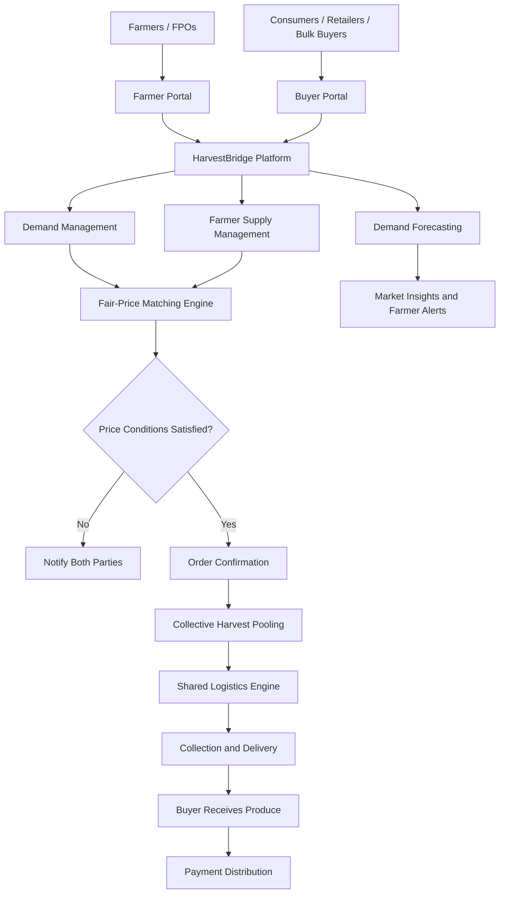

# Smart India Hackathon Workshop

**Date:** 24 November 2026

**Name:** M VIJAY VARSHAN

**Reference Number:** 26010204

---

# Problem Title

**SIH 26033 – Multiple intermediaries reduce farmers' earnings and increase consumer prices.**

**Organization:** Ministry of Consumer Affairs, Food & Public Distribution

**Theme:** Agriculture, FoodTech & Rural Development

---

# Problem Description
Expected Solution: Create a digital marketplace that:

- Connects farmers/FPOs directly with consumers and bulk buyers.
- Provides logistics support.
- Uses AI for demand forecasting and route optimization.

Benefits:

- Better prices for farmers. - Lower prices for consumers. - Reduced supply chain inefficiencies.

---

# Proposed Solution

## HarvestBridge – A Demand-Linked Agricultural Marketplace with Collective Logistics and Fair-Price Matching

### 1. Detailed Explanation of the Proposed Solution

HarvestBridge is a digital agricultural marketplace designed to connect farmers directly with consumers, retailers, restaurants, wholesalers and other bulk buyers.

The platform follows a demand-first trading mechanism in which buyers publish their agricultural requirements before farmers supply their produce.

Instead of depending on multiple commission-based intermediaries, farmers can negotiate directly with buyers, combine their produce with nearby farmers and coordinate shared transportation.

The solution consists of five major modules.

**A. Demand-First Ordering System**

- Buyers publish crop requirements, quantities, quality specifications and maximum purchasing prices.
- Farmers receive notifications about relevant buyer requirements.
- The system identifies suitable farmers based on crop availability, location and quantity.
- Farmers can accept or reject purchase requests.

**B. Collective Harvest Pooling**

- Nearby farmers can combine their agricultural produce to fulfil bulk orders.
- The system creates collective supply lots.
- Each farmer's contribution is recorded separately.
- Payments are calculated according to individual contributions.
- Small-scale farmers can participate in bulk transactions.

**C. Fair-Price Corridor Matching**

This module provides a transparent price-matching mechanism.

- Farmers specify their minimum acceptable selling price.
- Buyers specify their maximum acceptable purchasing price.
- The system compares both prices.
- If the buyer's maximum price is greater than or equal to the farmer's minimum price, the transaction becomes eligible for negotiation.
- Both parties confirm the final price before the order is completed.

**D. Shared Logistics Coordination**

- The platform identifies nearby farmers with compatible orders.
- Multiple deliveries are grouped into shared transportation routes.
- Collection points are used to consolidate agricultural produce.
- Transportation expenses are divided among participating orders.
- Buyers can track their orders.

**E. Demand Intelligence and Price Insights**

- The platform analyses previous transactions and buyer requirements.
- It identifies demand patterns for different crops.
- Farmers receive market-demand information.
- Historical transaction data is used to display indicative price trends.
- Farmers receive alerts about potential demand opportunities.

### 2. How It Addresses the Problem

| Existing Challenge | Proposed Solution |
|---|---|
| Multiple intermediaries | Direct farmer-to-buyer connection |
| Low farmer bargaining power | Fair-Price Corridor |
| Difficulty fulfilling bulk orders | Collective Harvest Pooling |
| Uncertain market demand | Demand-First Ordering |
| High transportation costs | Shared Logistics |
| Lack of price transparency | Digital Price Matching |
| Agricultural wastage | Demand-linked supply planning |
| Limited market access | Digital Marketplace |

### 3. Innovation and Uniqueness

HarvestBridge introduces a coordinated agricultural trading ecosystem.

1. Demand Before Harvest – Buyers publish requirements before farmers dispatch produce.
2. Collective Supply Formation – Small farmers combine produce to fulfil larger orders.
3. Fair-Price Corridor – Transactions are matched using buyer and farmer price limits.
4. Contribution-Based Payments – Every farmer's contribution is digitally recorded.
5. Shared Transportation – Compatible orders are grouped to reduce delivery expenses.
6. Demand Intelligence – Farmers receive insights about purchasing trends.

The combination of these mechanisms aims to create a transparent and farmer-controlled supply chain.

---

# Technical Approach

## 1. System Architecture

HarvestBridge uses a modular web-based architecture connecting farmers, buyers, a matching engine, collective supply management and logistics coordination.

### Technical Architecture Diagram

## 2. Working Methodology

**Step 1: User Registration**

Farmers, FPOs and buyers register on the platform.

**Step 2: Demand Publication**

Buyers enter their required crops, quantities, quality specifications, delivery locations and maximum purchasing prices.

**Step 3: Farmer Supply Registration**

Farmers list available crops, quantities, harvest dates and minimum acceptable selling prices.

**Step 4: Intelligent Matching**

The system compares buyer requirements with available farmer supplies based on crop type, quantity, quality, location and price.

**Step 5: Collective Harvest Pooling**

If an individual farmer cannot fulfil a bulk order, the system identifies nearby farmers who can collectively supply the required quantity.

**Step 6: Logistics Coordination**

The platform identifies suitable collection points and groups compatible deliveries into shared transportation routes.

**Step 7: Delivery and Payment**

After delivery confirmation, payments are distributed to individual farmers according to their recorded contributions and agreed prices.

**Step 8: Demand Analysis**

The system analyses previous transactions and generates market-demand insights for farmers.

## 3. Technologies to Be Used

| Component | Technology |
|---|---|
| Frontend | HTML, CSS, JavaScript, React |
| Backend | Python, Django, Django REST Framework |
| Database | PostgreSQL |
| Geographic Information | PostGIS, OpenStreetMap |
| Demand Forecasting | Python, Pandas, Scikit-learn |
| Route Optimization | OpenStreetMap Routing |
| Authentication | Django Authentication |
| Notifications | SMS, Email, In-app Notifications |
| Deployment | AWS / Cloud Hosting |

## 4. Core Algorithm – Fair-Price Matching

Let:

- Fmin = Farmer's minimum acceptable selling price per unit.
- Bmax = Buyer's maximum acceptable purchasing price per unit.

**Matching Condition:**

If Bmax >= Fmin, the transaction is eligible for matching.

If Bmax < Fmin, the transaction is not confirmed.

**Example:**

Farmer's minimum price = ₹20/kg.

Buyer's maximum price = ₹25/kg.

Negotiation range = ₹20–₹25/kg.

Both parties can negotiate and confirm a mutually acceptable price within this range.

---

# Feasibility and Viability

## 1. Feasibility of the Idea

HarvestBridge can be implemented using commonly available web development technologies.

- Farmers can access the platform through smartphones.
- Buyers can place orders through a web interface.
- PostgreSQL can maintain transaction and user information.
- Python algorithms can handle price matching and collective supply pooling.
- Demand forecasting can be introduced using historical transaction data.
- Mapping technologies can support logistics coordination.

The platform can initially be tested in a small agricultural region and gradually expanded.

## 2. Potential Challenges and Risks

| Challenge | Proposed Strategy |
|---|---|
| Limited digital literacy | Simple interface and regional-language support |
| Inconsistent produce quality | Quality verification at collection points |
| Order cancellation | Order confirmation and availability checks |
| Transportation delays | Delivery tracking and backup logistics |
| Incorrect demand predictions | Regular model updates |
| Payment disputes | Digital transaction records |
| Limited initial participation | FPO partnerships |

## 3. Implementation Strategy

**Phase 1 – Minimum Viable Product**

Develop user registration, farmer listings, buyer requirements and price matching.

**Phase 2 – Collective Trading**

Introduce collective supply pooling and contribution-based payment calculations.

**Phase 3 – Logistics Integration**

Implement collection-point management, route optimization and delivery tracking.

**Phase 4 – Intelligent Analytics**

Introduce demand forecasting, price trend analysis and farmer notifications.

---

# Impact and Benefits

## 1. Impact on Farmers

- Improved access to direct buyers.
- Better control over selling prices.
- Opportunities to participate in bulk orders.
- Reduced dependence on commission-based intermediaries.
- Better visibility of market demand.

## 2. Impact on Consumers and Buyers

- Direct access to agricultural produce.
- Potential reduction in additional distribution costs.
- Improved price transparency.
- Better product availability information.
- Improved delivery coordination.

## 3. Social, Economic and Environmental Benefits

**Economic Benefits**

- Improved farmer earnings through direct transactions.
- Potential reduction in consumer purchasing costs.
- Reduced transportation expenses through shared deliveries.
- Better utilization of agricultural supply.

**Social Benefits**

- Greater participation of small-scale farmers.
- Improved transparency in agricultural transactions.
- Better access to digital agricultural markets.

**Environmental Benefits**

- Reduced unnecessary transportation trips.
- Better harvesting and distribution coordination.
- Potential reduction in post-harvest food wastage.

## 4. Long-Term Impact

HarvestBridge aims to establish a scalable agricultural trading ecosystem in which farmers have greater control over their products, buyers receive transparent purchasing opportunities and agricultural logistics become more efficient.

---

# Research and References

1. Smart India Hackathon – SIH 26033 Problem Statement.
   https://github.com/selvasachein/SIH-26033

2. Ministry of Agriculture and Farmers Welfare.
   https://agriwelfare.gov.in/

3. e-NAM – National Agriculture Market.
   https://www.enam.gov.in/

4. Small Farmers' Agribusiness Consortium.
   https://sfacindia.com/

5. OpenStreetMap.
   https://www.openstreetmap.org/

6. Django Documentation.
   https://docs.djangoproject.com/

7. Scikit-learn Documentation.
   https://scikit-learn.org/stable/

8. PostgreSQL Documentation.
   https://www.postgresql.org/docs/

---

**Note:** HarvestBridge is a proposed solution. Its functionality and expected benefits require validation through prototype development and pilot testing.
